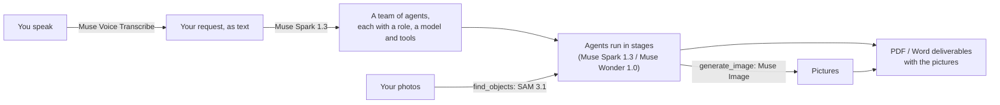

# AIMIx at the Meta Global AI Developer Hackathon 2026

**Track:** Startup · **Theme:** Build for Your World · **Team:** Oussama Fezzai
([@Fezzaioussama](https://github.com/Fezzaioussama)), solo

**Like a workflow builder such as n8n, without the drag and drop: you build your
AI agents by chatting (or speaking), and an orchestrator agent does the work.**

**Live in production at [aimix.win](https://aimix.win)**: a real product, not a
prototype (see [Live in production](#live-in-production)).

**Demo video (2:50):** [AIMIx: Build AI Agent Teams by Talking](https://www.youtube.com/watch?v=jKhtG-1C1ww)

## The idea

Workflow tools make you draw the automation: drag nodes onto a canvas, wire them,
configure each one. Most people who need the work done cannot, or do not have the
time. In AIMIx you just say what you want, in Missions:

1. **You chat, or speak.** "Plan the launch of my bakery's subscription, with a
   hero picture and a one-page PDF."
2. **AIMIx asks** what is missing, if anything essential is.
3. **It builds the team for you:** each agent gets a role, a Meta model and its
   tools, in stages that run in parallel. You see the team as a graph, and change
   it by talking to it.
4. **The orchestrator runs it:** the agents work, an orchestrator checks their
   results and sends work back for fixes, and you get finished files (PDF, Word,
   pictures).

The same team stays editable as a pipeline, and can run again or on a schedule.

## What existed before the event, and what was built during it

AIMIx existed before the hackathon: it is a multi-agent workflow platform started
in October 2025 (accounts, the pipeline builder, LangGraph runs, Missions, files,
schedules). Until the event it ran on OpenRouter and TogetherAI models only.

Everything below was built during the event (October 26 – November 4, 2026). The
commits are on `main`, after
[`428fda4`](https://github.com/Fezzaioussama/AIMIx/commit/428fda4); the three commits
from October 26 up to it only edit `AGENTS.md`, the contributor rules.

**The Meta entry:**

| Commit | What it adds |
|---|---|
| [`c6fe331`](https://github.com/Fezzaioussama/AIMIx/commit/c6fe331) | **Meta Model API as a provider.** Every agent, the planner and the chat can run on Muse Spark 1.3 or Muse Wonder 1.0, with tool calling, streamed usage and per-call cost from Meta's published prices |
| [`5d26d21`](https://github.com/Fezzaioussama/AIMIx/commit/5d26d21) | Meta named in the privacy policy, terms and site copy |
| [`674d4a4`](https://github.com/Fezzaioussama/AIMIx/commit/674d4a4) | **Build agents by voice.** A microphone in Missions; Muse Voice Transcribe turns the request into text, and the planner builds the team from it. The same microphone is in Chat, the builder's "Ask AIMIx to change this pipeline" and Auto Pipeline, so any work can be asked for by voice |
| [`03401f1`](https://github.com/Fezzaioussama/AIMIx/commit/03401f1) | **Agents that draw.** A `generate_image` tool on Muse Image; PDF and Word deliverables show the pictures; the results pane previews them |
| [`fed68fe`](https://github.com/Fezzaioussama/AIMIx/commit/fed68fe) | **Agents that see.** A `find_objects` tool on SAM 3.1 finds and counts every match of a phrase ("loaf of bread", "scratch") in a picture, and saves a copy with the matches numbered for the report |

**Also built during the event, for every model provider:**

| Commit | What it adds |
|---|---|
| [`f5eaf58`](https://github.com/Fezzaioussama/AIMIx/commit/f5eaf58), [`96007bc`](https://github.com/Fezzaioussama/AIMIx/commit/96007bc) | Missions ask a few questions before planning when the request leaves something essential open; every team ends with a final check that sends work back for fixes |
| [`81072a8`](https://github.com/Fezzaioussama/AIMIx/commit/81072a8), [`30bdfe4`](https://github.com/Fezzaioussama/AIMIx/commit/30bdfe4), [`f8c1675`](https://github.com/Fezzaioussama/AIMIx/commit/f8c1675) | GDPR self-service (export, delete, password), legal pages, AI-output notices, safer sign-up |
| [`6bd06a2`](https://github.com/Fezzaioussama/AIMIx/commit/6bd06a2) | Dependency updates for new security advisories |
| [`7977059`](https://github.com/Fezzaioussama/AIMIx/commit/7977059) | A sidebar for every section, one page frame, Settings in tabs |
| [`16f2aa7`](https://github.com/Fezzaioussama/AIMIx/commit/16f2aa7), [`41eb09d`](https://github.com/Fezzaioussama/AIMIx/commit/41eb09d) | Stronger teams: a team brief, filled inputs, retries that change something, a final check that sees every deliverable |
| [`5304fe9`](https://github.com/Fezzaioussama/AIMIx/commit/5304fe9), [`5f19725`](https://github.com/Fezzaioussama/AIMIx/commit/5f19725) | Agents read whole PDFs and scans, and web pages from a link; Missions take documents and links where you type |
| [`259952a`](https://github.com/Fezzaioussama/AIMIx/commit/259952a), [`a1c551b`](https://github.com/Fezzaioussama/AIMIx/commit/a1c551b), [`1133115`](https://github.com/Fezzaioussama/AIMIx/commit/1133115) | The Chat builds workflows and schedules too, remembers the conversation, and follows and steers runs |
| [`0e26803`](https://github.com/Fezzaioussama/AIMIx/commit/0e26803), [`e5bcbe4`](https://github.com/Fezzaioussama/AIMIx/commit/e5bcbe4) | Another app starts a workflow through its secret link; results go out to Slack, Discord or any webhook |
| [`67d9e99`](https://github.com/Fezzaioussama/AIMIx/commit/67d9e99), [`1d4a995`](https://github.com/Fezzaioussama/AIMIx/commit/1d4a995) | Pictures agents save show in the results; a PDF reports its page count, and a review round replaces its own draft, so a one-page brief stays one page |

## How Meta's models work together



| Meta model | What it does in AIMIx |
|---|---|
| Muse Voice Transcribe | Turns a spoken request into the text of a mission; you read it before sending |
| Muse Spark 1.3 | Plans the team (roles, stages, tools, a model per agent), runs most agents, and checks the results |
| Muse Wonder 1.0 | The planner gives it the steps that need the most reasoning or writing |
| Muse Image | Draws the pictures an agent asks for; they land in your files and your documents |
| SAM 3.1 | Finds and counts what an agent names in a photo, and marks each match for the report |

A real run, recorded while building: "launch a bakery's sourdough subscription"
became a team of three (an illustrator on Muse Wonder with `generate_image`, a
writer on Muse Spark with `save_artifact`, and a final check). It finished in 69
seconds for $0.11 and produced a one-page PDF launch plan with its hero picture.

## Live in production

AIMIx is not only a demo: it runs at **[aimix.win](https://aimix.win)**, with Meta
as its active provider. Everything in this entry is deployed there, from `main`,
on every push that passes CI.

- **The same bakery mission, run on the live site** (November 1, 2026): Muse Spark
  planned a team of five in four stages (a launch strategist; a food image stylist
  with `generate_image` and a copywriter, working together; a document designer
  with `save_artifact`; a final check). It finished in **45 seconds for $0.06** of
  model calls, and left a JPEG hero picture and a PDF launch plan with the picture
  in the user's files.
- **Built to run for real users:** accounts with encrypted per-user API keys, a
  cost and token limit on any run (every run on aimix.win is capped at $1), usage
  and cost per workflow, GDPR export and deletion, and legal pages.
- **Hardened:** HTTPS with HSTS preload, a strict Content Security Policy, the
  microphone allowed for the site itself only, login lockout and rate limits, one
  Docker image built and smoke-tested in CI before it ships.

Public sign-up is closed while the service is in early access; judges get a
demo login with the submission.

## Engineering notes

- One provider registry: Meta was added as one registry entry and one client
  module. Speech and images reuse that client, the same retries and the same error
  contract.
- Spending stays bounded: any run can carry a cost and token limit (the run form
  asks for one, and `RUN_MAX_COST_USD` caps them all: $1 per run on aimix.win), and
  Meta calls are priced from the catalogue because the API reports no cost.
- Privacy by design: recordings are never stored, and the cheaper `-contributor`
  models (which let Meta train on requests) are left out on purpose. Meta marks
  each picture as AI-generated in its metadata, and AIMIx keeps that mark.
- Every change ships with tests: about 2,090 backend tests (pytest) and 1,490
  frontend tests (vitest) run on every push, alongside lint, type checks and the build.

## Run it

```bash
make install
cp backend/.env.example backend/.env
make migrate
make run-aimix            # backend :8000, frontend :4200
```

Sign in, open **Settings**, choose **Meta** and paste a Meta Model API key from
[dev.meta.ai](https://dev.meta.ai). Then go to **Missions**, press the microphone
and say what you need.

## Demo

Video (2:50): [AIMIx: Build AI Agent Teams by Talking](https://www.youtube.com/watch?v=jKhtG-1C1ww).
The bakery scenes and the narration are AI-generated (HeyGen, Gemini TTS); all app
footage is recorded live on aimix.win, with long runs sped up.
