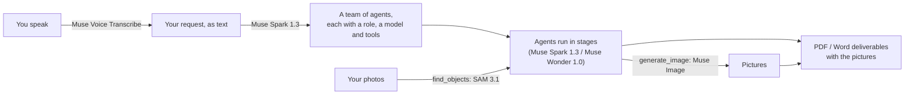

# AIMIx at the Meta Global AI Developer Hackathon 2026

**Track:** Startup · **Theme:** Build for Your World · **Team:** Oussama Fezzai
([@Fezzaioussama](https://github.com/Fezzaioussama)), solo

**Say what you need, and a team of Meta-powered AI agents plans it, does it, and
hands you finished files.**

## What existed before the event, and what was built during it

AIMIx existed before the hackathon: it is a multi-agent workflow platform started
in October 2025 (accounts, the pipeline builder, LangGraph runs, Missions, files,
schedules). Until the event it ran on OpenRouter and TogetherAI models only.

Everything below was built during the event (October 26 – November 4, 2026). The
commits are on `main`, after
[`428fda4`](https://github.com/Fezzaioussama/AIMIx/commit/428fda4); the three commits
from October 26 up to it only edit `AGENTS.md`, the contributor rules.

**The Meta entry:**

| Commit | What it adds |
|---|---|
| [`c6fe331`](https://github.com/Fezzaioussama/AIMIx/commit/c6fe331) | **Meta Model API as a provider.** Every agent, the planner and the chat can run on Muse Spark 1.3 or Muse Wonder 1.0, with tool calling, streamed usage and per-call cost from Meta's published prices |
| [`5d26d21`](https://github.com/Fezzaioussama/AIMIx/commit/5d26d21) | Meta named in the privacy policy, terms and site copy |
| [`674d4a4`](https://github.com/Fezzaioussama/AIMIx/commit/674d4a4) | **Build agents by voice.** A microphone in Missions; Muse Voice Transcribe turns the request into text, and the planner builds the team from it |
| [`03401f1`](https://github.com/Fezzaioussama/AIMIx/commit/03401f1) | **Agents that draw.** A `generate_image` tool on Muse Image; PDF and Word deliverables show the pictures; the results pane previews them |
| [`fed68fe`](https://github.com/Fezzaioussama/AIMIx/commit/fed68fe) | **Agents that see.** A `find_objects` tool on SAM 3.1 finds and counts every match of a phrase ("loaf of bread", "scratch") in a picture, and saves a copy with the matches numbered for the report |

**Also built during the event, for every model provider:**

| Commit | What it adds |
|---|---|
| [`f5eaf58`](https://github.com/Fezzaioussama/AIMIx/commit/f5eaf58), [`96007bc`](https://github.com/Fezzaioussama/AIMIx/commit/96007bc) | Missions ask a few questions before planning when the request leaves something essential open; every team ends with a final check that sends work back for fixes |
| [`81072a8`](https://github.com/Fezzaioussama/AIMIx/commit/81072a8), [`30bdfe4`](https://github.com/Fezzaioussama/AIMIx/commit/30bdfe4), [`f8c1675`](https://github.com/Fezzaioussama/AIMIx/commit/f8c1675) | GDPR self-service (export, delete, password), legal pages, AI-output notices, safer sign-up |
| [`6bd06a2`](https://github.com/Fezzaioussama/AIMIx/commit/6bd06a2) | Dependency updates for new security advisories |

## How Meta's models work together



| Meta model | What it does in AIMIx |
|---|---|
| Muse Voice Transcribe | Turns a spoken request into the text of a mission; you read it before sending |
| Muse Spark 1.3 | Plans the team (roles, stages, tools, a model per agent), runs most agents, and checks the results |
| Muse Wonder 1.0 | The planner gives it the steps that need the most reasoning or writing |
| Muse Image | Draws the pictures an agent asks for; they land in your files and your documents |
| SAM 3.1 | Finds and counts what an agent names in a photo, and marks each match for the report |

A real run, recorded while building: "launch a bakery's sourdough subscription"
became a team of three (an illustrator on Muse Wonder with `generate_image`, a
writer on Muse Spark with `save_artifact`, and a final check). It finished in 69
seconds for $0.11 and produced a one-page PDF launch plan with its hero picture.

## Engineering notes

- One provider registry: Meta was added as one registry entry and one client
  module. Speech and images reuse that client, the same retries and the same error
  contract.
- Spending stays bounded: every run has a cost and token ceiling, and Meta calls
  are priced from the catalogue because the API reports no cost.
- Privacy by design: recordings are never stored, and the cheaper `-contributor`
  models (which let Meta train on requests) are left out on purpose. Meta marks
  each picture as AI-generated in its metadata, and AIMIx keeps that mark.
- Every change ships with tests: about 1,790 backend tests (pytest) and 890
  frontend tests (vitest) run on every push, alongside lint, type checks and the build.

## Run it

```bash
make install
cp backend/.env.example backend/.env
make migrate
make run-aimix            # backend :8000, frontend :4200
```

Sign in, open **Settings**, choose **Meta** and paste a Meta Model API key from
[dev.meta.ai](https://dev.meta.ai). Then go to **Missions**, press the microphone
and say what you need.

## Demo

Video: *(link added at submission)*
