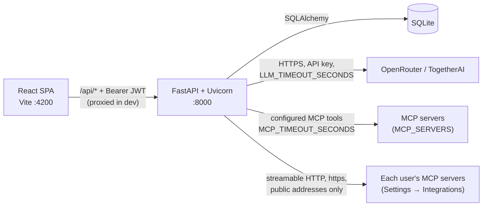
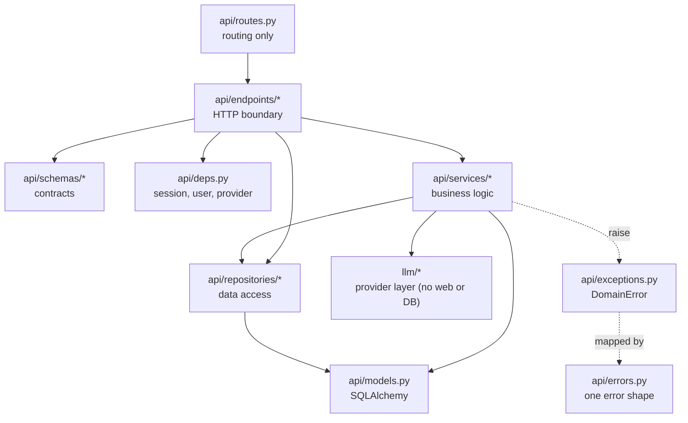
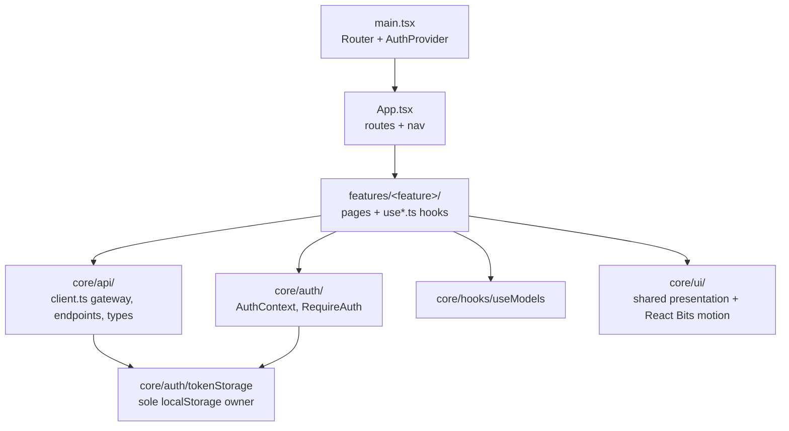
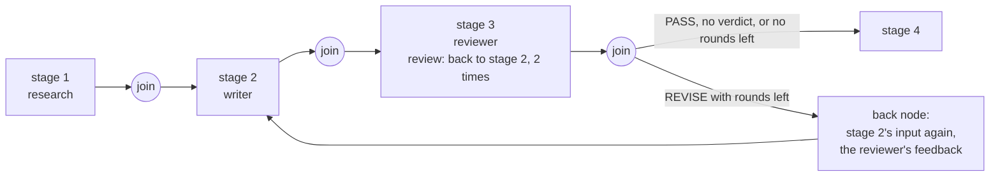
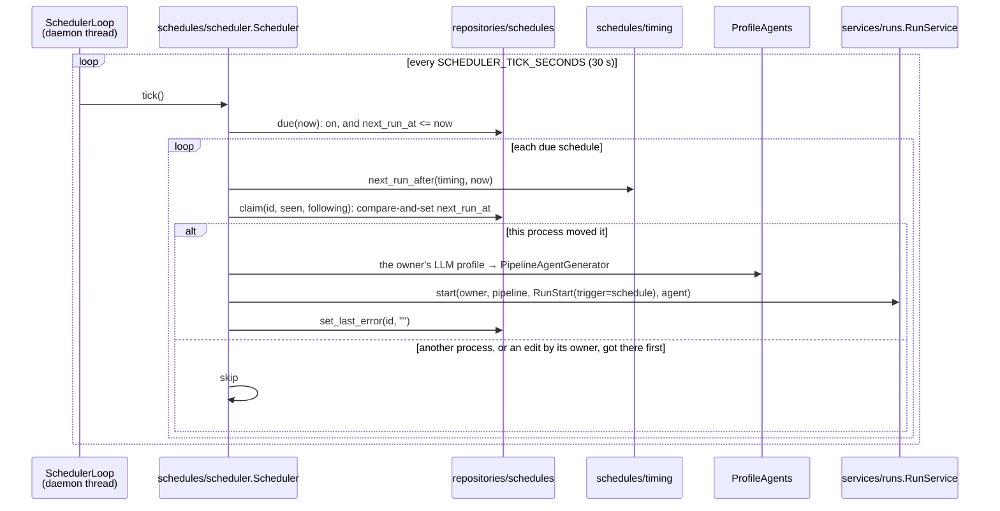
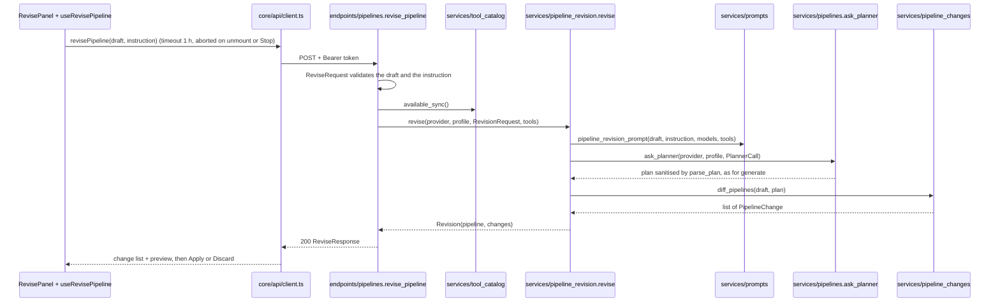
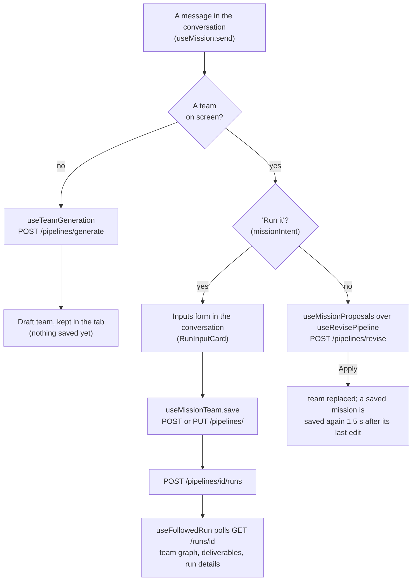

# Architecture

## System view



The backend is a **chokepoint**: it holds the provider API key (the browser never
sees it), validates every model id against a catalogue, and bounds every
outbound call with a timeout. It also holds each user's integration header
values (encrypted, never sent back) and is the only thing that talks to those
servers.

## Backend layers



Rules that keep this shape (full text in [AGENTS.md §2](../AGENTS.md)):

- **Endpoints are thin**: FastAPI validates the body against a pydantic schema,
  the endpoint calls a service or repository and returns a response schema. No
  business `if`s, no prompt building.
- **Protected by default**: every router except those in `PUBLIC_ROUTERS` is
  mounted behind the `current_user` dependency.
- **Services never touch HTTP**: they take and return plain Python values and
  dataclasses, and signal failure by raising a `DomainError`.
- **Only `api/errors.py` builds error responses**, always as
  `{"error": "<code>", "detail": "<message>"}`.
- **`llm/` never imports the web framework, the database or settings**: it
  receives a `ProviderConfig` dataclass.
  Only `api/services/llm.py` reads provider settings.
- **Ownership filtering lives in `api/repositories/`**, so "another user's
  pipeline" and "no such pipeline" look identical (404).

## Frontend layers



Components render and handle input. `fetch`, the bearer token, timeouts, and
error mapping live in `core/api/client.ts`; feature state lives in a
`use<Feature>.ts` hook next to the page.

## Request traces

### 1. Run a pipeline — `POST /api/pipelines/<id>/runs`, then poll `GET /api/runs/<id>`

A run executes in the background of the API process, never inside the request
that starts it (AGENTS.md §6). It is saved first, so every run is in the
history, can be followed live, stopped, resumed and found again later.

```mermaid
sequenceDiagram
    participant UI as useLatestRun / useRun
    participant C as core/api/runs.ts
    participant E as endpoints/runs
    participant S as services/runs.RunService
    participant D as repositories/runs
    participant X as services/run_executor
    participant G as services/multiagent/graph
    participant A as services/multiagent/step_agent
    participant O as services/run_recorder
    UI->>C: startRun(id, input)
    C->>E: POST /pipelines/<id>/runs + Bearer token
    E->>E: FastAPI validates {"input"} / {"inputs"} against RunRequest
    E->>S: start(user, pipeline (owned, else 404), RunStart, step agent)
    S->>S: prepare_run: ensure_runnable, snapshot_pipeline, bind_run_inputs (400, nothing saved)
    S->>D: create: run "queued" + one "pending" row per step, snapshot as JSON
    S->>X: submit(run id, job)
    E-->>C: 202 RunOut (queued)
    Note over X: one asyncio loop on a daemon thread; at most RUN_MAX_CONCURRENT jobs, the rest wait queued
    X->>O: begin(): queued → running (compare-and-set)
    X->>G: arun(snapshot, agent, inputs, RunControl(observer, completed))
    loop each stage, its steps concurrently (PIPELINE_MAX_PARALLEL_STEPS)
        G->>O: STARTED → step row "running" (own short transaction)
        G->>A: execute(task + run_step): model, role, tools (agent_runtime; MCP_SERVERS + enabled integrations via mcp_connections_for, a failing integration skipped), and the step's usage meter
        Note over A,O: every model call: the run's meter checks its limit first (refused: budget_exceeded), then adds the call's tokens and cost to the step row
        Note over A: a tool that must ask first waits for the owner (run "waiting", see Approval gates)
        A-->>G: final text, tool name/status trace and usage, or DomainError
        G->>O: SUCCEEDED / FAILED / CANCELLED → step row
        G->>G: join the stage; merge outputs in saved order
    end
    X->>O: end(): succeeded, or failed (code + detail) — compare-and-set
    loop every RUN_POLL_INTERVAL_MS (1.5 s) while queued, running or waiting
        UI->>C: getRun(id)
        C->>E: GET /runs/<id>
        E->>D: get_owned(user, id) with steps and pending approvals (another user's is 404)
        E-->>UI: RunOut: status, every step so far, outputs as soon as saved, pending_approvals
    end
```

**Who writes a run.** Every status change is a compare-and-set in
`repositories/runs` (`set_status`, `set_step`, `end`, `reopen`): it applies only
from the statuses the caller expects, so a request thread and the executor
never overwrite each other. The executor's job owns `queued → running →
succeeded | failed`; the step events come from the graph through the
`StepObserver` port (`RunRecorder` writes each in its own transaction,
synchronously on the run's loop, so a run's events stay in order).

**Usage, cost and limits.** Each step's agent wraps its chat model with
`llm.usage.metered`, so a LangChain callback hears every model call of its
tool loop: it reads the answer's token counts and prices the call (what the
provider reports it charged, else the model's catalogue price, else unknown;
see [LLM providers](llm-providers.md#usage-and-cost)). The callback reports to
the `UsageMeter` the graph put in the step's `AgentTask`, which is a
`run_budget.RunMeter` shared by every step of the execution. Before a call the
meter checks the run's limits against the running total (kept under a lock, so
parallel steps never lose or double an update) and refuses with
`BudgetExceeded` once one is reached; after a call it adds the usage to the total
and `RunRecorder.record_usage` adds it to the step's row at once
(`SET x = x + n`, one short transaction on the run's loop). A refused call fails
its step and so the run: `failed` with `budget_exceeded`, finished steps kept,
the parallel sibling cancelled like for any failure. A call in flight when the
limit is reached still finishes and is counted, so a run may pass its limit by
the calls then running. The totals shown to users (`RunOut.usage`, `GET /usage`)
are computed from the step rows, never stored. A resume gets the run's earlier
spending as its starting total and may raise the limits
(`POST /runs/<id>/resume` with a body); under a limit it has already reached it
is refused (`409 budget_exceeded`).

**The server's limits** (`run_policy.RunPolicy`, applied by `RunService` on every
path that starts or resumes a run). A limit the starter leaves unset takes the
default (`RUN_DEFAULT_MAX_COST_USD`, `RUN_DEFAULT_MAX_TOKENS`); the ceilings
(`RUN_MAX_COST_USD`, `RUN_MAX_TOKENS`) refuse a limit asked for above them and
cut a default or a saved limit to them (`run_budget.RunLimits`). Only a token
limit bounds a model with no known price. An account may have
`RUN_MAX_ACTIVE_PER_USER` runs queued, running or waiting: `repositories/quota`
counts them in the same transaction as the insert (or the resume) that adds one,
after locking the owner's row, so requests sent together cannot pass it together
(`429 too_many_runs`).

**Stop** (`POST /runs/<id>/cancel`): the request writes `cancelled` (from
`queued`, `running` or `waiting`), marks running steps `cancelled` and expires
the approvals still pending, then asks the executor to cancel the task.
LangGraph cancels the in-flight agents, whose model calls are cut at once (an
agent waiting at an approval gate is cut the same way); a run still waiting for
a slot simply never starts. Stopping a finished run changes nothing. The
stopped task may take a moment to wind down (a tool call it cannot abandon); its
last write, `interrupted`, only applies to a run still `running`, so a resume
must not start a new attempt before it has ended: `RunExecutor.settled(run_id)`
waits up to `RUN_SHUTDOWN_GRACE_SECONDS` for that, and the resume is otherwise a
`409 conflict` ("still stopping").

**Interrupted.** On shutdown (FastAPI lifespan) the executor cancels its jobs;
a cancelled job records `interrupted`, unless its owner stopped it first (then
it stays `cancelled`). On startup, `interrupt_abandoned_runs` marks anything a
previous process left `queued`, `running` or `waiting` (a crash, a hard kill)
as `interrupted`, and its pending approvals as `expired`. Both can be resumed;
a resumed run asks again.

**Resume** (`POST /runs/<id>/resume`, from `failed`, `cancelled` or
`interrupted`): the run is queued again with the requester's current model and
key, steps that neither succeeded nor were skipped are reset to `pending`, and
the graph runs the run's own snapshot with `RunControl.completed` holding the
saved results: those steps are not executed again, so the run continues from
the first stage that did not fully succeed (inside a review loop, where it was:
see below). Resuming any other run returns it unchanged.

**Waiting callers.** `POST /pipelines/<id>/run` (kept for API compatibility)
and the chat agent's `run_pipeline` tool start a run the same way and wait for
its end (`RunService.run_to_end`), so their runs are recorded too. The wait is
bounded by `RUN_WAIT_MAX_SECONDS`: then `RunStillRunning` (`202
run_still_running`) frees the request thread and the run goes on, so callers
that wait cannot pin the threadpool every synchronous endpoint shares.

#### Conditions and review loops

A step may carry a **condition** ("run this step only if…") and a **review**
("send the work back for fixes"); both are step fields saved with the pipeline,
stored in a run's snapshot, and checked when a pipeline is saved
(`services/pipeline_flow`: an unknown input or step, a step that does not run
earlier, a review that does not go to an earlier stage, loops that share a
stage) and again when a run starts. The rules themselves are pure functions
(`multiagent/conditions.py`, `reviews.py`); the graph only applies them.



**Conditions.** `StepNode` (`multiagent/nodes.py`) decides for its step, right
before it would start: a result an earlier attempt saved *for this round* is
reused; otherwise the condition is read from the stage's input, the run's named
inputs and the outputs so far (`ConditionTexts`) and, when it does not hold, the
step is **skipped** (event `SKIPPED`, status `skipped`, empty output); otherwise
its agent runs. A skipped step is final and kept by a resume. The stage's join
merges only the steps that ran, so one step left passes its output on unchanged
and a stage that skipped every step hands its own input on.

**Loops.** `multiagent/loops.py` turns each usable review into a `ReviewLoop`
(the stages from its target to its reviewer) and adds a conditional edge to the
reviewer's join. A reviewer's answer is read when its step finishes
(`reviews.read_verdict`): the last line that holds only `VERDICT: PASS` or
`VERDICT: REVISE` becomes the step's `verdict` and is taken out of its output.
After the join, the router sends the work back when the verdict says so and the
loop has rounds left: the "back" node restores the input the target stage had
(`GraphState.stage_inputs`), stores the reviewer's answer as the loop's
feedback and counts the round (`GraphState.loops`); the stages then run again in
order. Their steps are told the round they are in: the steps of the stage the
work went back to get the feedback block (or `{feedback}`), and every step
reports `STARTED` or, for a step that already finished in an earlier round,
`RESTARTED` with its `round`, so the recorder updates **the same row in place**
(status back to `running`, output replaced, `rounds` set; usage keeps adding up).
The graph's step limit grows with the rounds a loop may add
(`loops.recursion_limit`), and a review that cannot work or shares a stage with
an earlier loop is ignored with a warning, so a run is bounded whatever the data
holds. Two loops may not share a stage: that is the simpler of the two ways to
keep one round counter per step, and it is refused when a pipeline is saved.

**Resume inside a loop.** A step's row keeps the round it was last in, and a
reviewer's row keeps its `verdict` and answer; that is all a resumed run needs.
`loops.initial_loops` reads each loop's round from the newest `rounds` of any
step in its stages (one time fewer than that, the work had been sent back) and
the feedback from the reviewer's saved answer while it still holds it. The graph
then runs from the first stage as usual, but a saved result is reused only when
it belongs to the round the loop is in, so: stopped while a stage was being
redone → that stage runs again in the same round with the feedback, the
reviewer's older answer is not reused; stopped between two rounds → the saved
`REVISE` sends the work back; a loop that ended (`PASS`, or the last round's
`REVISE`) is not run again and a later failed step runs alone. The one loss is
the feedback of a step that shares the reviewer's stage and places `{feedback}`
itself: if the run stopped after the reviewer began the next round but before that
step did, the step is given an empty `{feedback}` (known-issues.md, entry 10).

#### Extension points

| Need | Hook |
|---|---|
| A new way for a condition to compare, or a new thing for it to look at | One entry in `conditions.CONDITION_OPERATORS` or `CONDITION_SOURCES` (`multiagent/conditions.py`); the editor's words are `CONDITION_OPERATORS` and `SOURCE_CHECKS` in `frontend/src/features/pipelines/stepFlow.ts` and `stepFlowProblems.ts`. The graph needs no change. |
| A new verdict a reviewer can give | One entry in `reviews.VERDICTS` (the word and whether it sends the work back); the prompt rule is in `flow_prompts.REVIEWER_RULE`. |
| React to a skipped or redone step | `StepObserver.on_step_event` already hears `SKIPPED` and `RESTARTED` with the review `round`; `run_recorder.STEP_CHANGES` says which statuses each may follow. |
| React to each step (notifications, exports) | Implement `StepObserver.on_step_event(StepEvent)` (`multiagent/contracts.py`). New data goes in a new optional field of `StepEvent` or `StepResult` (an agent fills it through `AgentOutcome`); the graph's control flow does not change. The graph awaits the observer, so it can also hold a step back. `StepResult.usage` already carries each step's tokens and cost. |
| Count or cap what model calls use | Implement `llm.usage.UsageMeter` (`before_call()` may raise to refuse a call; `after_call(usage)`) and hand it to the steps through `RunControl.meter` (step order → meter). `run_budget.RunMeter` is the run's budget; a new limit kind is one entry in `run_budget.LIMITS`, a new way to learn a call's cost one entry in `llm.usage.COST_SOURCES`. |
| Hold a tool call for a person (approval gates, built) | A tool asks first when `ApprovalPolicy.asks(name, source)` says so (`approvals/policy.py`: `MCP_REQUIRE_APPROVAL`, each integration's switch, `AGENT_APPROVAL_TOOLS`). To gate something else, add the source or tool name to the policy; the guard and the middleware need no change. See [Approval gates](#approval-gates). |
| Pause a run another way | End the run in a new status from the job (`RunService._execute`) and let `resume` continue it; `RunControl.completed` already skips the finished steps. Add the status to `RunStatus` and, if it can continue, to `RESUMABLE_RUN_STATUSES` (`api/models.py`); mirror it in `frontend/src/features/runs/runStatus.ts` and `RUN_STATUS_STYLES`. |
| Start runs without a request | `RunService(database, executor, max_parallel_steps).start(user, pipeline, RunStart(text, values, trigger, schedule_id), agent)`; the app's executor is `app.state.run_executor` (`RunExecutor`: `submit(key, job) -> Future`, `cancel(key)`, `shutdown()`). Schedules do exactly this, see [Scheduled runs](#scheduled-runs). A new kind of starter adds a member to `RunTrigger` (`api/models.py`) and to `RunTrigger` in `frontend/src/core/api/types.ts`. |
| Show a run on another screen | `const live = useRun(runId)` then `<LiveRun run={live.run} onStop={live.stop} onResume={live.resume} onApprove={live.approve} onDecline={live.decline} busy={live.busy} error={live.error} actions={…}>…</LiveRun>` (`features/runs`). Without `onApprove` and `onDecline` a waiting run's requests are shown but cannot be answered on that screen. |

A pipeline may declare named inputs. `pipeline_inputs.bind_run_inputs` checks
the request against them before the graph starts: the first stage receives
their values (labelled when there are several), and the values travel in the
graph state so that `prompts.step_prompt` can fill `{name}` in a step of any
stage, next to `{input}`, the stage's input.

Each agent uses its selected model and optional role, and a system prompt from
`prompts.step_agent_system_prompt` that states the step's expected output when
it has one and, when the agent has tools, tells it to use them instead of
guessing, cite web sources and adapt when a tool fails.
`allowed_tools: null` grants the signed-in user's pipeline list and inspect
tools, the enabled built-in web, calculation, clock and local workspace tools
(see below), all configured MCP tools and the tools of the user's enabled
integrations; `[]` grants none;
an explicit list grants only named tools. A missing selected tool raises
`tool_unavailable`, naming it. The graph keeps step results in saved order even if agents
finish out of order. Each step records its tool calls' names and success/error
statuses, without arguments or tool output. A built-in tool that fails (a page
that times out, a refused address, a bad expression) returns an error result
to the agent, which can retry another way; the call shows as `error` in the
trace and the run continues. Model, MCP, and timeout failures stop the run:
it is recorded as `failed` with the error, a parallel step still working is
cancelled, the steps that succeeded keep their outputs, and the run can be
resumed.

### Scheduled runs

A schedule starts runs of one pipeline on its own: "every Monday at 09:00, Paris
time". It is a row of the `schedules` table (owner, pipeline, a preset
frequency, a wall-clock time and an IANA time zone, the run inputs, `enabled`,
`next_run_at` in UTC, `last_error`), and a run it starts is marked
`Run.trigger = schedule` with `Run.schedule_id`, which the history shows.
Everything runs inside the API process.



- **When** (`services/schedules/timing.py`, pure, no clock): each preset is one
  rule in `FREQUENCIES` (Strategy + Registry): hourly, daily, weekdays, weekly
  (a weekday) and monthly (a day of the month). A time is read on the zone's
  wall clock, so "09:00" stays 09:00 across daylight-saving changes. The night
  the clocks go forward, a time in the skipped hour runs as much later as they
  jumped (02:30 becomes 03:30); the night they go back, a time that happens twice
  runs once, the first time; an hourly schedule follows real hours, so it runs
  both times through a repeated hour and not in a skipped one; a day past the end
  of a month (the 31st in April) is that month's last day. `checked` is the one
  place that validates a timing (a zone from `available_timezones()`, the day its
  preset needs) and clears the fields the preset does not use. The standard
  library's `zoneinfo` does all of this; no scheduling dependency was added.
- **Once per occurrence.** `claim` is a compare-and-set that moves `next_run_at`
  from the time the tick saw to its first time after now, and only the caller
  whose update applied starts the run. Two processes (or two ticks) that both
  listed the same due schedule therefore start one run between them, and an edit
  by the owner that changed the schedule's next time makes the claim fail. A
  schedule that is overdue after downtime runs **once**, not once per missed
  time, because the claim jumps to the first time after *now*. The claim comes
  before the start, so a process that dies in between loses that one occurrence
  rather than starting it twice.
- **The same path as a manual run.** `Scheduler._start` loads what the schedule
  holds at that moment (its inputs may have been edited since the tick began),
  resolves the owner's LLM profile with `llm_settings.resolve_profile` and builds
  a `PipelineAgentGenerator` (`ProfileAgents`), then calls `RunService.start`:
  the inputs are bound by `bind_run_inputs` like any run's, the run is saved
  queued and handed to the executor, and the scheduler does not wait for it.
  `ProfileAgents` checks that a key exists first (`provider_config`), so an
  account with none gets an explanation on the schedule instead of a run that can
  only fail. The run gets the schedule's own limits (`max_cost_usd`,
  `max_tokens`), within the server's like any run.
- **One run at a time.** After the claim, a schedule whose previous run is still
  queued, running or waiting (`repositories/active_runs.of_schedule`) skips the
  occurrence: no run, `last_error` says which run was still in progress, and the
  log says `schedule.skipped`. So a pipeline that takes longer than its schedule's
  interval runs every other time instead of piling up queued runs.
- **Failures** never stop the loop. A `DomainError` raised while starting (no API
  key, inputs the pipeline no longer takes, a pipeline without steps) is saved in
  `schedules.last_error` and logged as `schedule.start_failed`; any other
  exception is logged with its traceback and recorded as `server_error`. Either
  way the schedule has already moved to its next time. A start that works clears
  `last_error`, and so does an edit by the owner that changes what the schedule
  runs or when (or turns it on): that new configuration has not failed yet.
- **Lifecycle.** The app's `lifespan` starts `app.state.scheduler` after
  `interrupt_abandoned_runs` and stops it before it shuts the run executor down,
  so no run is submitted to an executor that is stopping. With
  `SCHEDULER_ENABLED=false` the app holds an `IdleScheduler` (Null Object): the
  schedules stay saved and none starts. Tests set it false and drive
  `Scheduler.tick()` with a clock they control and the inline run executor.
- **Validation at save time** (`schedules/service.py`): the pipeline is the
  user's, its inputs pass `prepare_run` (the rules a run applies), the timing
  passes `checked`, its limits are within the server's ceiling, and the account
  keeps at most `SCHEDULES_MAX_PER_USER` (counted in the insert's own
  transaction, through `repositories/quota`).
  Turning a schedule off always works; turning it on, or changing its inputs,
  checks them again. While its timing is unchanged, saving keeps the saved
  `next_run_at`, so an occurrence that is due is not postponed by an edit.
- **In the UI.** The builder's "Schedule this pipeline" panel creates one; the
  Runs screen has a Schedules view (`/runs/schedules`). Both show the schedule in
  plain words, and "next run" comes from `POST /api/schedules/preview`, the same
  `next_run_after` the scheduler uses, so what the form promises is what the
  server does, daylight saving included.

### Built-in tools

`api/services/toolbox/` gives agents real work to do without any MCP server.
`registry.py` maps each tool name to a builder (Strategy + Registry);
`AGENT_BUILTIN_TOOLS` picks the entries on offer, and a builder returns nothing
when its tool is not configured, so `web_search` appears only when
`TAVILY_API_KEY` is set. `tools.py` adapts the helpers into LangChain tools with
`handle_tool_error`; `web.py` is the httpx gateway (Tavily search, page fetch);
`calculator.py` evaluates arithmetic over a whitelisted AST, never `eval`, and
refuses arguments whose cost grows with their value (`**` past 4096 result bits,
`round` past 1235 digits), since one huge integer operation holds the GIL and
would stall every request;
`html_text.py` reduces HTML to readable text; `workspace.py` lists, searches and
reads (text and CSV as written, PDF and Word through the run-document readers)
and saves new artifacts in the user's folder, `AGENT_WORKSPACE_DIR/user-<id>`
(`files/storage.user_workspace_dir`). Where a path may lead is not decided there
but in `api/services/files/storage.WorkspaceStorage`, the one confinement core
the Files page uses too: relative, visible paths only, nothing outside the
folder, no link followed, no overwrite unless the caller asks, and at most
`WORKSPACE_MAX_TOTAL_BYTES` per user. It raises domain errors; the toolbox hands
them to the model as tool errors, the HTTP layer returns them as they are.
`save_artifact` writes text formats as given and lays out Markdown as `.docx`
or `.pdf` through `api/services/artifacts` (one Markdown parse, then a renderer
per extension from the `RENDERERS` registry). `agent_tools.native_tools` joins
them with the pipeline tools, so pipeline agents, the chat agent, the planner
and `GET /agent-tools` all see the same set.

What agents save, users see: `GET /api/files` lists the same folder, uploads
land where agents read, and downloads are always attachments with a sandbox CSP,
so stored HTML never runs as a page of the app's origin.

`fetch_url` only reaches public addresses: every redirect hop is resolved and
refused if any address is loopback, private, link-local, multicast, site-local
or otherwise non-global (an IPv6 address carrying an IPv4 one, such as NAT64
`64:ff9b::/96` or 6to4, is judged by the IPv4 address), which keeps a
prompt-injected agent out of the server's network and cloud metadata endpoint.
The connection itself goes through `api/services/outbound.py`: its httpcore
network backend resolves the host, checks every address and connects to one of
exactly those addresses (TLS and the `Host` header still name the host), so a
DNS server that answers differently the second time (DNS rebinding) cannot
redirect it, and environment proxies never apply. Outbound web tools are
automatically removed when workspace readers are offered unless the operator
explicitly sets `AGENT_ALLOW_WORKSPACE_NETWORK_ACCESS=true`. Bodies are asked
for unencoded; gzip or deflate is still decoded by the transport in 64 KB
pieces (any other encoding is refused), so a compressed bomb stops at
`WEB_FETCH_MAX_BYTES` like any page. The text handed to the model stops at
`WEB_FETCH_MAX_CHARS`, each request at `WEB_TIMEOUT_SECONDS`, and the whole
call, redirects included, at `WEB_FETCH_MAX_SECONDS`, with no retries. A page
whose charset is not a text codec (`zlib`, `idna`) is read as UTF-8.

`run_python` lets an agent run code for data analysis and charts, offered only
when `E2B_API_KEY` is set. Code never runs in the web process: `sandbox.py`
defines the `CodeSandbox` port (Adapter) and one call's lifecycle, and
`e2b_sandbox.py`, the only importer of the e2b-code-interpreter SDK, creates a
fresh E2B cloud sandbox per call with no internet access, authenticated URLs,
a lifetime of `SANDBOX_TIMEOUT_SECONDS` and kill-on-timeout. One deadline of
that same timeout covers the whole call (creating the sandbox, uploading the
inputs, running the code, collecting its files); it starts before the sandbox
exists, so the call, not the sandbox's death, decides when it timed out. The
sandbox is closed in a shielded `finally`, so an error, a timeout or a
cancelled agent still destroys it, and creating it is shielded too: a sandbox
that was being created when the deadline or a cancellation arrived is still
received, then closed, instead of running unseen until its own lifetime ends.
Every account may make `SANDBOX_MAX_CALLS_PER_HOUR` calls an hour, counted in
the database-backed rate-limit table (`agent_tools.sandbox_quota`, applied by
the `sandbox.metered` opener before a sandbox is created), since each one
spends the server's E2B key. `code_runner.py` reads the `input_files`
through `workspace.py` (same confinement and size limit, and a symlink to a
hidden file stays hidden) into `/home/user/inputs/`, saves what the code
writes to `/home/user/outputs/` and the PNG charts it displays into a new
`sandbox/<UTC time>/` workspace folder (`outputs/` and `charts/` inside it; at
most `SANDBOX_MAX_FILES` files within `WORKSPACE_MAX_FILE_BYTES`, never
overwriting, a `.csv` through the same formula neutraliser as `save_artifact`),
and returns the error with a short traceback, the saved files,
the files not saved and why, the final result, stdout and stderr, cut at
`SANDBOX_MAX_OUTPUT_CHARS`. Outputs are downloaded as streams and dropped once
they outgrow the file limit; one that cannot be fetched is reported without
failing the call. A run that streams back more than
`SANDBOX_MAX_STREAM_CHARS` is stopped, because the SDK holds all of it in
memory; the SDK reads each message whole, so one single huge message is not
bounded by it. An exception in the code, a timeout and an E2B failure are
error results the agent can react to. The SDK is async, so
sandbox calls do not block the event loop; workspace disk work runs in a
worker thread. `sandbox.run` is logged with its outcome and duration, never
the code or its output.

`run_python` counts as a workspace reader, since its `input_files` read the
workspace, so when it is offered it also removes the outbound web tools unless
`AGENT_ALLOW_WORKSPACE_NETWORK_ACCESS=true` (without an E2B key it is not
offered and removes nothing). It is not outbound itself: E2B
creates the sandbox with `allow_internet_access=False`, which denies all of its
outbound traffic, so the code can only hand data back to the agent. The code
(which can embed anything in the agent's context) and the input files the
agent names do leave the server for E2B, the operator's chosen provider, the
way prompts go to the LLM provider.

### MCP servers and tool discovery

Agents get MCP tools from two places: the operator's `MCP_SERVERS` (shared,
trusted configuration, HTTP or stdio) and each user's own **integrations**
(Settings → Integrations, `api/services/integrations/`). One function,
`integrations.connections.mcp_connections_for(database, user, settings)`, builds
both into an `MCPConnections(operator, user)` value; the chat agent
(`agent.py`), pipeline step agents (`multiagent/step_agent.py`) and the
catalogue (`tool_catalog.py`, behind `GET /agent-tools` and the planner) all
call it, so they always agree on what a user can reach.

Whether those tools may act without asking is a separate question, answered per
source by the [approval policy](#approval-gates): an operator server asks while
`MCP_REQUIRE_APPROVAL` is on, an integration while its own switch is on.

`mcp_discovery.discover_tools` loads the tools, every name prefixed with its
server's name:

- **Operator servers** load together, as before: if one fails, discovery fails
  with `tool_unavailable`, and duplicate names among native and operator tools
  are refused.
- **Integrations** load one by one through `load_server_tools`, the adapter
  that turns any MCP SDK failure into a `ToolUnavailable` with a plain reason.
  One that fails is skipped with a logged warning
  (`integration.discovery_skipped`), so runs and chats that do not need it keep
  working; a step that *selected* one of its tools then fails in
  `agent_runtime.resolve_tools`, because the tool is missing. A tool whose name
  is taken or is not a valid model-API function name is dropped, and the rest
  are tagged with their integration so the catalogue shows its name as the
  source.

The builder skips (and logs) an integration whose name an operator server now
uses, whose URL the current settings refuse, or whose header values
`SECRET_KEY` can no longer decrypt.

Users' servers are untrusted input to the server's network, so they are held
to the `fetch_url` rules, which live in `api/services/addresses.py` for both:
streamable HTTP only (never stdio, which would run a command on this server),
`https` (plain `http` only when `APP_ENV=local`), and a host that resolves only
to public addresses. The check runs when an integration is saved, before a
connection test, and on **every** connection to it: the integration's
connection carries a `GuardedClientFactory` whose clients use the
`outbound.py` transport (each discovery and tool call opens its own session),
so each connection resolves the host, checks every address and connects to
one of exactly those, leaving no DNS-rebinding window, and no environment
proxy applies. The MCP SDK follows redirects only within the same origin, and
that connection is checked too. One HTTP response from a user's server (a JSON
answer or an event stream) stops past `MCP_MAX_RESPONSE_BYTES`, decompressed
size included, and every MCP tool's result, an operator server's too, reaches
the model with its text cut at `MCP_TOOL_RESULT_MAX_CHARS` (`ResultCap`, a
tool-call interceptor in `mcp_discovery.py`). Local development reaches a
server on `127.0.0.1` with `APP_ENV=local` and
`INTEGRATIONS_ALLOW_PRIVATE_NETWORK=true`, which skips the address check but
keeps the size limits; production refuses to start with that setting.

The graph lives in `api/services/multiagent/`: `contracts.py` defines immutable
pipeline and step snapshots, results, the async step-agent contract and the
step observer port (`StepEvent`, `StepObserver`, `RunControl`); `mapper.py`
copies loaded ORM records into a `PipelineSpec` and stores it as JSON for a
run (`spec_to_json` / `spec_from_json`); `graph.py` composes one node per saved
step and a barrier after each stage; `step_agent.py` binds the selected model,
role, and tools. `pipelines.py` checks a run's inputs (`prepare_run`) and plans
pipelines; `runs.py` owns the run lifecycle. Chat and pipeline agents share
tool policy and error mapping in `agent_runtime.py`.

A run's durable state is its database rows (one per step), not a LangGraph
checkpoint: progress is saved step by step, and resuming re-enters the graph
with the saved results. A tool that can act on an outside system waits for the
owner's OK first (next section).

### Approval gates

A tool from an MCP server can change something outside AIMIx (send an email,
update a CRM). Inside a run, such a call stops at a **gate** until the run's
owner approves or declines it. `api/services/approvals/` holds the parts:

| Module | Role |
|---|---|
| `policy.py` | `approval_policy_for(database, user, settings)` is the one place that decides which tool calls ask first; it returns an immutable `ApprovalPolicy` (Value Object) that travels with the tools (`AgentToolset.approvals`). |
| `guard.py` | `guard_tools(toolset, tools, gate)` applies the policy to an agent's resolved tools, for chat and step agents alike, and `run_gate` builds a step's gate. |
| `middleware.py` | `ApprovalMiddleware`, a LangChain agent middleware (Decorator) whose `awrap_tool_call` holds each call of a gated tool at the gate, and runs the tool itself only once it is approved. |
| `gate.py` | The `ApprovalGate` port and `RunApprovalGate`, which records the request and waits for the answer in the database. |
| `decisions.py` | `answer()`, the owner's approve or decline, and `settle()`, the one compare-and-set that ends a request. |
| `preview.py` | `preview_arguments`: the call's arguments as JSON the owner reads, within `APPROVAL_ARGUMENTS_MAX_CHARS`. |

**Which calls ask first.** A tool asks when its *source* asks, or when its name
is in `AGENT_APPROVAL_TOOLS` (meant for built-in tools such as `save_artifact`;
default none). Sources, as `tool_catalog.source_of` names them: every tool of
the operator's `MCP_SERVERS` while `MCP_REQUIRE_APPROVAL` is on (the default),
and every tool of one of the user's integrations whose "Ask me before its tools
act" switch is on (`Integration.require_approval`, on by default, also for
integrations saved before it existed). The policy is read for each step's
agent, so a switch changed in Settings applies from the next step.

```mermaid
sequenceDiagram
    participant A as step agent (LangChain)
    participant M as ApprovalMiddleware
    participant G as RunApprovalGate
    participant D as database (run_approvals, runs)
    participant U as the owner (UI)
    A->>M: tool call crm_send_email(args)
    M->>G: ask(ToolRequest)
    G->>D: approval "pending" and run "running" → "waiting" (one transaction)
    loop every APPROVAL_POLL_SECONDS (1 s), asyncio.sleep in between
        U->>D: GET /runs/<id> lists pending_approvals
        G->>D: read the approval's status
    end
    U->>D: POST /runs/<id>/approvals/<id>/approve (or decline)
    D-->>G: "approved" (or "declined"); the run is "running" again
    G-->>M: APPROVED
    M->>A: the tool runs and its result goes back to the agent
    Note over M,A: declined or expired: no tool call, the agent gets an error result and goes on
```

**The wait.** The gate polls the database instead of holding an in-memory
event, so an answer reaches it whichever thread (or process) took the request,
and `asyncio.sleep` keeps the run's event loop free for other runs. The step
stays `running`; the run shows `waiting` for as long as any of its approvals is
pending (`repositories/approvals`: recording a request moves it there, settling
the last pending one moves it back), and `waiting` counts as active everywhere
`queued` and `running` do (`ACTIVE_RUN_STATUSES`: stop, no delete, restart
recovery, polling). Several steps may ask at once, each with its own request.

**How a request ends**, always one compare-and-set from `pending`, so the
owner, the timeout and a stopped run never overwrite one another:

| Outcome | When | What the agent gets |
|---|---|---|
| `approved` | The owner approves in time | The tool's own result |
| `declined` | The owner declines | An error result: "The user declined this action. Do not repeat it: continue without it…" |
| `expired` | Nobody answers within `APPROVAL_TIMEOUT_SECONDS` (default 1800), or the run is stopped, the step fails or times out, the server shuts down or restarts | An error result (a stopped run's agent is cancelled instead) |

The step's trace shows a declined or expired call as `error`. An answer after
the time is up expires the request instead (`409 conflict`); the same answer
twice changes nothing. The wait counts toward the step's
`AGENT_TIMEOUT_SECONDS`, so a request never waits longer than that either. A
request is never recorded for a run that is no longer executing.

**Where nobody can be asked.** The chat has no run to pause, so the tools that
ask first are not offered to the chat agent (it can still start a pipeline
run, whose steps ask). The same goes for a step outside a recorded run
(`pipelines.run`, used by tools and tests). `POST /pipelines/<id>/run` and the
chat's `run_pipeline` tool wait for a run's end, so a run of theirs that asks
keeps them waiting until it is answered (or expires); the owner answers it from
the Runs page.

**What is stored and logged.** One `run_approvals` row per request: the run,
step, tool name, source, description, the arguments (JSON, long text values
shortened), status, and `created_at`, `expires_at` and `decided_at`. Arguments
are for the owner's eyes only: `approval.requested` and `approval.decided` log
ids, step, tool name and outcome, never the arguments. Stopping a run logs each
request it was waiting on as `approval.decided … outcome=expired`; after a
crash, startup recovery logs only how many runs it interrupted
(`run.interrupted_on_startup`), and their requests expire with them.

### 2. Stream chat — `POST /api/chat`

1. `useChatStream.send` adds the user message and an empty AI message, then
   iterates `streamChatReply()` → `client.streamText()`, which reads
   `response.body.getReader()` and yields decoded chunks.
2. `endpoints/chat.chat` validates `{"prompt"}` and calls
   `services/chat.stream_reply(agent, prompt)`.
3. `services/agent` builds a chat-only LangGraph agent from the configured
   model, binds the signed-in user's native pipeline tools, and discovers tools
   from every server in `MCP_SERVERS` and the user's enabled integrations. Graph execution runs in one producer
   task, which sends assistant text through a queue. Model and MCP calls have
   timeouts; tool results stay out of the text stream. Shared tool policy and
   error mapping live in `services/agent_runtime`. A chat has no run to pause,
   so tools that must ask the owner first (see [Approval gates](#approval-gates))
   are not offered to it.
4. `stream_reply` **pulls the first chunk eagerly**. If agent setup or a tool
   fails before text appears, a `DomainError` is raised while the response is
   still uncommitted, so the client gets a real 5xx error body.
5. After the first chunk the response is a `StreamingResponse`
   (`text/plain`); Starlette iterates the async generator. A failure
   mid-stream can no longer change the status, so it is logged
   (`chat.stream_interrupted`) and the stream simply ends.
6. The hook appends each chunk to the AI message; unmounting aborts the fetch.

### 3. Generate a pipeline — `POST /api/pipelines/generate`

1. `GenerateRequest` validates `description` and an optional
   `planner_model` (defaults to the configured default model).
2. `services/tool_catalog` discovers the native pipeline tools, the
   configured MCP tools and the user's integration tools.
   `services/pipelines.generate` builds a prompt with
   their names and descriptions plus the allowed model ids, then calls the
   direct provider adapter.
3. `parse_plan` extracts the first `{...}` block, parses JSON, requires `name`
   and a non-empty `steps` list, fills a missing `order`, replaces unknown model
   ids with the default, removes unavailable names from explicit tool
   allowlists, clips each step's `expected_output`, and keeps only the planned
   `inputs` whose names follow the same rule the save endpoint enforces. A
   planned `condition` or `review` is read into its stored form, and each one
   that cannot work in the plan (the checks of `services/pipeline_flow`) is set
   to `null`: a planner's slip never fails the request.
   Unusable output → `upstream_response_invalid` (502).
4. The endpoint returns the plan **without saving it**. The user edits it in
   `AutoPipelinePage` and saves through the normal `POST /api/pipelines/`.

`GET /api/agent-tools` uses the same catalogue and returns each tool's exact
name, description, and source for the builder: `AIMIx`, `MCP`, or the name of
the user's integration it comes from.

### 4. Revise a pipeline — `POST /api/pipelines/revise`



1. The draft is the builder's or the auto page's current pipeline, saved or not.
   `PipelineDraftIn` checks it like a save, except that its name and step
   prompts may be blank, and `instruction` is non-blank and bounded.
2. `prompts.pipeline_revision_prompt` is built from the same
   `PIPELINE_PLANNER_GUIDE` as the generation prompt (tools, inputs, step
   fields, stages, reply format) plus the revision rules: change only what was
   asked, copy every other step exactly, keep `{input}` and `{name}` valid, add
   or remove inputs only when needed. The draft (as JSON) and the instruction
   are user data, so each sits in its own tagged block; the tags are stripped
   from the content, so it cannot close its block and pass for instructions.
3. `pipelines.ask_planner` is the one call-and-parse path, shared with
   `generate`: provider failures map through `PROVIDER_ERROR_MAP`, and the
   answer goes through `parse_plan` (unusable output → 502).
4. `pipeline_changes.diff_pipelines` is a pure function: it pairs steps (same
   content, then title, then prompt, then position), compares fields and
   inputs, and reports a stage change only when a step really runs at another
   point; a step's `condition` and `review` are compared as fields of the step.
   The endpoint returns the revision, the changes and the models. A draft may
   hold a flow that does not work yet: only a save checks it, and the planner's
   answer is cleaned up as for generation.
5. **Nothing is saved.** Apply in the UI replaces the draft and marks it
   unsaved; the user saves through `POST`/`PUT /api/pipelines/`. A proposal
   belongs to the draft it was made from, so editing the draft sets it aside.

### 5. The mission workspace — one screen over the other flows

`/mission` adds no endpoint and no table. It is the browser composing flows 1, 3
and 4 (run, generate, revise) and the pipeline save endpoints into one screen, with
a routing decision on every message (`features/mission/useMission.ts`):



- **A mission is a pipeline.** A new one is a draft held by the page (and its
  `sessionStorage` entry) until it first runs; the run saves it, then the address
  becomes `/mission/<id>`. Reopening it is `GET /pipelines/<id>/` plus its newest run
  (`GET /runs?pipeline_id=<id>&limit=1`), which `useLatestRun` keeps polling while it
  is active.
- **One writer for the team.** `useMissionTeam` owns the team on screen and is the
  only thing that saves it: one request at a time, edits made during a save kept and
  saved next, and the team object keeps its identity across a save so a revision
  proposal made for it (which belongs to the draft it was made from) stays valid.
- **The conversation is client state.** Messages are JSON (`missionMessages.ts`);
  the live parts of an answer — the open proposal, the run form, the newest run — are
  not stored in them but read from the hooks, so a message restored in another visit
  shows its outcome (or "no longer available") rather than a dead button.
  `sessionStorage` holds it per tab; it is validated on the way back in.
- **Runs are not tied to the screen.** Leaving it never stops a run (flow 1); the
  screen only follows the newest run of its pipeline.

## Error flow

```
llm/ retries a transient failure (llm/retry.py), then raises LLMError subclass
  → services translate via api/services/errors.PROVIDER_ERROR_MAP
  → DomainError (code + status) propagates out of the endpoint
  → FastAPI calls the handler installed by api/errors.install_error_handlers
  → {"error": code, "detail": message} with the mapped status
  → core/api/client.ts turns it into ApiError(message, status, code)
```

Request validation errors become 400 `validation_error`. Framework HTTP errors
(unknown route 404, 405, …) are mapped by `STATUS_CODES` in `api/errors.py`. An
unexpected exception becomes a 500 `server_error` and is still logged by the
server — never a 200 with an error inside.

## Design patterns in use

| Pattern | Where | Why |
|---|---|---|
| Registry + Factory | `llm/registry.py`, `api/services/llm.get_provider` | New provider = one dict entry, no `if` chain |
| Adapter | `llm/base.OpenAICompatibleProvider`, `api/services/multiagent/mapper.py`, `step_agent.py` | Wrap provider SDKs, snapshot ORM records, and bind agents to a graph port |
| Strategy map | `api/services/errors.PROVIDER_ERROR_MAP`, `api/services/mcp_discovery.REASONS` | Provider error → domain error, MCP failure → plain reason, each in one place |
| Decorator (retry) | `llm/retry.Retrier`, `llm/agent_models.RetryingChatModel` | One bounded retry policy around every model call, direct or LangChain |
| Strategy + Registry | `api/services/artifacts/registry.RENDERERS`, `docx_writer` / `pdf_writer` (`singledispatch` per block) | New artifact format = one renderer and one entry; new Markdown block = one writer each |
| Gateway | `api/services/files/storage.WorkspaceStorage` | One set of path, overwrite and quota rules for the agents' tools and the Files page |
| Repository | `api/repositories/pipelines.py`, `users.py` | Ownership-scoped queries and atomic writes |
| Graph orchestration | `api/services/multiagent/graph.py` | Concurrent agent nodes and a stage join with deterministic output order |
| Observer + Null Object | `StepObserver` / `SILENT_OBSERVER` in `multiagent/contracts.py`, `services/run_recorder.RunRecorder` | The graph reports step events without knowing who listens; persistence is one listener |
| Background executor | `api/services/run_executor.py` (`RunExecutor`, `BackgroundRunExecutor`) | Runs leave the request path; bounded concurrency; swappable in tests |
| Observer port + Null Object | `llm/usage.UsageMeter` / `UNMETERED`, `UsageCallback` | The model layer reports each call's usage without knowing who counts it; a run's budget is one listener |
| Strategy chain + Registry | `llm/usage.COST_SOURCES`, `api/services/run_budget.LIMITS` | Where a call's cost comes from (reported, catalogue, unknown) and which kinds of limit exist, each one entry |
| Compare-and-set | `api/repositories/runs.py`, `api/repositories/approvals.py`, `api/repositories/schedules.claim` | Request threads and the executor change a run's status, and the owner, the timeout and a stopped run settle an approval, without overwriting each other; two processes never start the same scheduled occurrence |
| Decorator (middleware) | `api/services/approvals/middleware.ApprovalMiddleware` | A gated tool keeps its own checks and result format; the gate wraps each call |
| Port + Adapter | `approvals/gate.ApprovalGate`, `RunApprovalGate` | The middleware asks a port; the database-backed gate is one implementation, a scripted one serves tests |
| Value Object | `approvals/policy.ApprovalPolicy` | Which tools ask first, resolved once and passed with the tools |
| Strategy + Registry | `api/services/schedules/timing.FREQUENCIES`; `frontend/src/features/schedules/scheduleDraft.FREQUENCIES` | A new frequency preset is one entry, never another branch |
| Strategy + Registry | `multiagent/conditions.CONDITION_OPERATORS` / `CONDITION_SOURCES`, `multiagent/reviews.VERDICTS`; `frontend/src/features/pipelines/stepFlow.CONDITION_OPERATORS`, `stepFlowProblems.SOURCE_CHECKS` | A new comparison, kind of source or verdict is one entry, never another branch |
| Observer events + Compare-and-set | `StepEventKind.RESTARTED` / `SKIPPED`, `run_recorder.STEP_CHANGES` | A review loop redoes a step in its own row and a skipped step ends without running, each only from the statuses it may follow |
| Value Object | `StepCondition`, `StepReview`, `LoopState`, `Feedback` | Frozen data crossing the layers: the stored flow fields, a loop's progress, a reviewer's feedback |
| Null Object | `api/services/schedules/scheduler.IdleScheduler` | `SCHEDULER_ENABLED=false` leaves the lifespan code unchanged |
| Dependency Injection | `api/deps.py` | Session, settings, user and provider swappable in tests |
| Application Factory | `api/main.create_app` | One place wires settings, database, middleware and routes |
| Builder | `api/services/prompts.py` | Prompt text kept apart from transport |
| DTO / Value Object | `StepResult`, `RunResult`, `ProviderConfig`, `ModelInfo` | Frozen dataclasses across layers |
| Gateway | `frontend/src/core/api/client.ts` | Token, timeout, error mapping in one place |
| Provider/Context | `frontend/src/core/auth/AuthContext.tsx` | Shared auth state |
