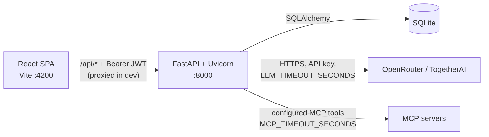
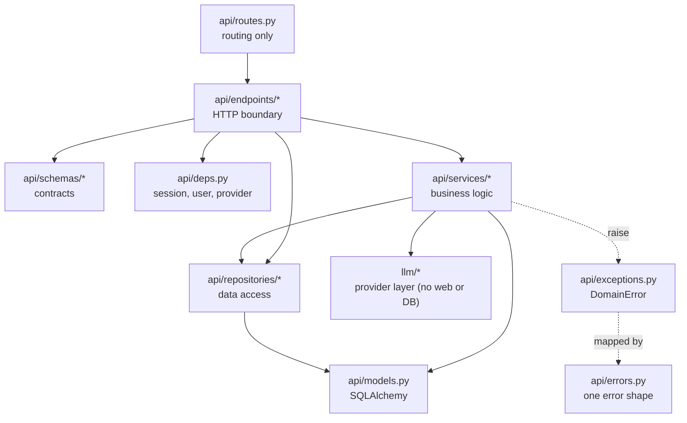
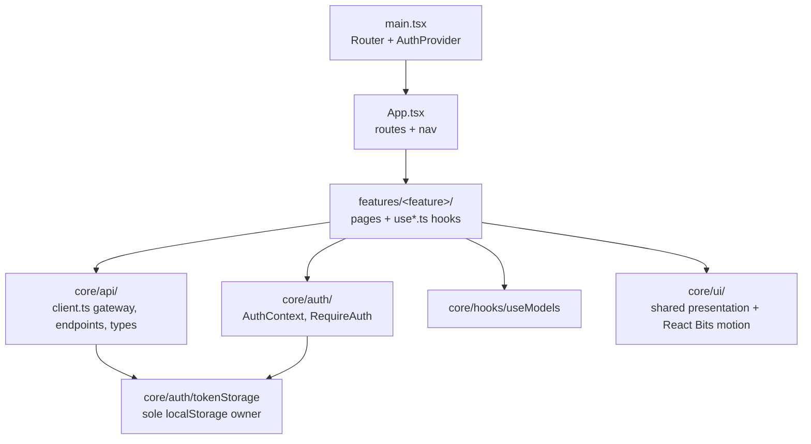

# Architecture

## System view



The backend is a **chokepoint**: it holds the provider API key (the browser never
sees it), validates every model id against a catalogue, and bounds every
outbound call with a timeout.

## Backend layers



Rules that keep this shape (full text in [AGENTS.md §2](../AGENTS.md)):

- **Endpoints are thin**: FastAPI validates the body against a pydantic schema,
  the endpoint calls a service or repository and returns a response schema. No
  business `if`s, no prompt building.
- **Protected by default**: every router except those in `PUBLIC_ROUTERS` is
  mounted behind the `current_user` dependency.
- **Services never touch HTTP**: they take and return plain Python values and
  dataclasses, and signal failure by raising a `DomainError`.
- **Only `api/errors.py` builds error responses**, always as
  `{"error": "<code>", "detail": "<message>"}`.
- **`llm/` never imports the web framework, the database or settings**: it
  receives a `ProviderConfig` dataclass.
  Only `api/services/llm.py` reads provider settings.
- **Ownership filtering lives in `api/repositories/`**, so "another user's
  pipeline" and "no such pipeline" look identical (404).

## Frontend layers



Components render and handle input. `fetch`, the bearer token, timeouts, and
error mapping live in `core/api/client.ts`; feature state lives in a
`use<Feature>.ts` hook next to the page.

## Request traces

### 1. Run a pipeline — `POST /api/pipelines/<id>/runs`, then poll `GET /api/runs/<id>`

A run executes in the background of the API process, never inside the request
that starts it (AGENTS.md §6). It is saved first, so every run is in the
history, can be followed live, stopped, resumed and found again later.

```mermaid
sequenceDiagram
    participant UI as useLatestRun / useRun
    participant C as core/api/runs.ts
    participant E as endpoints/runs
    participant S as services/runs.RunService
    participant D as repositories/runs
    participant X as services/run_executor
    participant G as services/multiagent/graph
    participant A as services/multiagent/step_agent
    participant O as services/run_recorder
    UI->>C: startRun(id, input)
    C->>E: POST /pipelines/<id>/runs + Bearer token
    E->>E: FastAPI validates {"input"} / {"inputs"} against RunRequest
    E->>S: start(user, pipeline (owned, else 404), RunStart, step agent)
    S->>S: prepare_run: ensure_runnable, snapshot_pipeline, bind_run_inputs (400, nothing saved)
    S->>D: create: run "queued" + one "pending" row per step, snapshot as JSON
    S->>X: submit(run id, job)
    E-->>C: 202 RunOut (queued)
    Note over X: one asyncio loop on a daemon thread; at most RUN_MAX_CONCURRENT jobs, the rest wait queued
    X->>O: begin(): queued → running (compare-and-set)
    X->>G: arun(snapshot, agent, inputs, RunControl(observer, completed))
    loop each stage, its steps concurrently (PIPELINE_MAX_PARALLEL_STEPS)
        G->>O: STARTED → step row "running" (own short transaction)
        G->>A: execute(task): model, role, tools (agent_runtime, tool_catalog, MCP)
        A-->>G: final text and tool name/status trace, or DomainError
        G->>O: SUCCEEDED / FAILED / CANCELLED → step row
        G->>G: join the stage; merge outputs in saved order
    end
    X->>O: end(): succeeded, or failed (code + detail) — compare-and-set
    loop every RUN_POLL_INTERVAL_MS (1.5 s) while queued or running
        UI->>C: getRun(id)
        C->>E: GET /runs/<id>
        E->>D: get_owned(user, id) with steps (another user's is 404)
        E-->>UI: RunOut: status, every step so far, outputs as soon as saved
    end
```

**Who writes a run.** Every status change is a compare-and-set in
`repositories/runs` (`set_status`, `set_step`, `end`, `reopen`): it applies only
from the statuses the caller expects, so a request thread and the executor
never overwrite each other. The executor's job owns `queued → running →
succeeded | failed`; the step events come from the graph through the
`StepObserver` port (`RunRecorder` writes each in its own transaction,
synchronously on the run's loop, so a run's events stay in order).

**Stop** (`POST /runs/<id>/cancel`): the request writes `cancelled` (from
`queued` or `running`) and marks running steps `cancelled`, then asks the
executor to cancel the task. LangGraph cancels the in-flight agents, whose
model calls are cut at once; a run still waiting for a slot simply never
starts. Stopping a finished run changes nothing.

**Interrupted.** On shutdown (FastAPI lifespan) the executor cancels its jobs;
a cancelled job records `interrupted`, unless its owner stopped it first (then
it stays `cancelled`). On startup, `interrupt_abandoned_runs` marks anything a
previous process left `queued` or `running` (a crash, a hard kill) as
`interrupted`. Both can be resumed.

**Resume** (`POST /runs/<id>/resume`, from `failed`, `cancelled` or
`interrupted`): the run is queued again with the requester's current model and
key, steps that did not succeed are reset to `pending`, and the graph runs the
run's own snapshot with `RunControl.completed` holding the saved results:
those steps are not executed again, so the run continues from the first stage
that did not fully succeed. Resuming any other run returns it unchanged.

**Waiting callers.** `POST /pipelines/<id>/run` (kept for API compatibility)
and the chat agent's `run_pipeline` tool start a run the same way and wait for
its end (`RunService.run_to_end`), so their runs are recorded too.

#### Extension points

| Need | Hook |
|---|---|
| React to each step (token and cost tracking, notifications) | Implement `StepObserver.on_step_event(StepEvent)` (`multiagent/contracts.py`). New data goes in a new optional field of `StepEvent` or `StepResult` (an agent fills it through `AgentOutcome`); the graph's control flow does not change. The graph awaits the observer, so it can also hold a step back. |
| Pause a run (approval gates) | End the run in a new status from the job (`RunService._execute`) and let `resume` continue it; `RunControl.completed` already skips the finished steps. Add the status to `RunStatus` and, if it can continue, to `RESUMABLE_RUN_STATUSES` (`api/models.py`); mirror it in `frontend/src/features/runs/runStatus.ts` and `RUN_STATUS_STYLES`. |
| Start runs without a request (schedules) | `RunService(database, executor, max_parallel_steps).start(user, pipeline, RunStart(...), agent)`; the app's executor is `app.state.run_executor` (`RunExecutor`: `submit(key, job) -> Future`, `cancel(key)`, `shutdown()`). |
| Show a run on another screen | `const live = useRun(runId)` then `<LiveRun run={live.run} onStop={live.stop} onResume={live.resume} busy={live.busy} error={live.error} actions={…}>…</LiveRun>` (`features/runs`). |

A pipeline may declare named inputs. `pipeline_inputs.bind_run_inputs` checks
the request against them before the graph starts: the first stage receives
their values (labelled when there are several), and the values travel in the
graph state so that `prompts.step_prompt` can fill `{name}` in a step of any
stage, next to `{input}`, the stage's input.

Each agent uses its selected model and optional role, and a system prompt from
`prompts.step_agent_system_prompt` that states the step's expected output when
it has one and, when the agent has tools, tells it to use them instead of
guessing, cite web sources and adapt when a tool fails.
`allowed_tools: null` grants the signed-in user's pipeline list and inspect
tools, the enabled built-in web, calculation, clock and local workspace tools
(see below), and all configured MCP tools; `[]` grants none;
an explicit list grants only named tools. A missing selected tool raises
`tool_unavailable`. The graph keeps step results in saved order even if agents
finish out of order. Each step records its tool calls' names and success/error
statuses, without arguments or tool output. A built-in tool that fails (a page
that times out, a refused address, a bad expression) returns an error result
to the agent, which can retry another way; the call shows as `error` in the
trace and the run continues. Model, MCP, and timeout failures stop the run:
it is recorded as `failed` with the error, a parallel step still working is
cancelled, the steps that succeeded keep their outputs, and the run can be
resumed.

### Built-in tools

`api/services/toolbox/` gives agents real work to do without any MCP server.
`registry.py` maps each tool name to a builder (Strategy + Registry);
`AGENT_BUILTIN_TOOLS` picks the entries on offer, and a builder returns nothing
when its tool is not configured, so `web_search` appears only when
`TAVILY_API_KEY` is set. `tools.py` adapts the helpers into LangChain tools with
`handle_tool_error`; `web.py` is the httpx gateway (Tavily search, page fetch);
`calculator.py` evaluates arithmetic over a whitelisted AST, never `eval`;
`html_text.py` reduces HTML to readable text; `workspace.py` confines file listing,
search, text/CSV reads and new artifacts to a per-user directory below
`AGENT_WORKSPACE_DIR`, without hidden
paths, symlink traversal or overwrites. `agent_tools.native_tools` joins
them with the pipeline tools, so pipeline agents, the chat agent, the planner
and `GET /agent-tools` all see the same set.

`fetch_url` only reaches public addresses: every redirect hop is resolved and
refused if any address is loopback, private, link-local or otherwise
non-global, which keeps a prompt-injected agent out of the server's network and
cloud metadata endpoint. httpx resolves the host again when it connects, so a
DNS-rebinding window remains; drop `fetch_url` from `AGENT_BUILTIN_TOOLS` where
that is unacceptable. Outbound web tools are automatically removed when
workspace readers are enabled unless the operator explicitly sets
`AGENT_ALLOW_WORKSPACE_NETWORK_ACCESS=true`. Downloads stop at `WEB_FETCH_MAX_BYTES`, the text handed
to the model at `WEB_FETCH_MAX_CHARS`, and each request at
`WEB_TIMEOUT_SECONDS`, with no retries.

The graph lives in `api/services/multiagent/`: `contracts.py` defines immutable
pipeline and step snapshots, results, the async step-agent contract and the
step observer port (`StepEvent`, `StepObserver`, `RunControl`); `mapper.py`
copies loaded ORM records into a `PipelineSpec` and stores it as JSON for a
run (`spec_to_json` / `spec_from_json`); `graph.py` composes one node per saved
step and a barrier after each stage; `step_agent.py` binds the selected model,
role, and tools. `pipelines.py` checks a run's inputs (`prepare_run`) and plans
pipelines; `runs.py` owns the run lifecycle. Chat and pipeline agents share
tool policy and error mapping in `agent_runtime.py`.

A run's durable state is its database rows (one per step), not a LangGraph
checkpoint: progress is saved step by step, and resuming re-enters the graph
with the saved results. Tool actions still run without an approval step.

### 2. Stream chat — `POST /api/chat`

1. `useChatStream.send` adds the user message and an empty AI message, then
   iterates `streamChatReply()` → `client.streamText()`, which reads
   `response.body.getReader()` and yields decoded chunks.
2. `endpoints/chat.chat` validates `{"prompt"}` and calls
   `services/chat.stream_reply(agent, prompt)`.
3. `services/agent` builds a chat-only LangGraph agent from the configured
   model, binds the signed-in user's native pipeline tools, and discovers tools
   from every server in `MCP_SERVERS`. Graph execution runs in one producer
   task, which sends assistant text through a queue. Model and MCP calls have
   timeouts; tool results stay out of the text stream. Shared tool policy and
   error mapping live in `services/agent_runtime`.
4. `stream_reply` **pulls the first chunk eagerly**. If agent setup or a tool
   fails before text appears, a `DomainError` is raised while the response is
   still uncommitted, so the client gets a real 5xx error body.
5. After the first chunk the response is a `StreamingResponse`
   (`text/plain`); Starlette iterates the async generator. A failure
   mid-stream can no longer change the status, so it is logged
   (`chat.stream_interrupted`) and the stream simply ends.
6. The hook appends each chunk to the AI message; unmounting aborts the fetch.

### 3. Generate a pipeline — `POST /api/pipelines/generate`

1. `GenerateRequest` validates `description` and an optional
   `planner_model` (defaults to the configured default model).
2. `services/tool_catalog` discovers the native pipeline tools and the
   configured MCP tools. `services/pipelines.generate` builds a prompt with
   their names and descriptions plus the allowed model ids, then calls the
   direct provider adapter.
3. `parse_plan` extracts the first `{...}` block, parses JSON, requires `name`
   and a non-empty `steps` list, fills a missing `order`, replaces unknown model
   ids with the default, removes unavailable names from explicit tool
   allowlists, clips each step's `expected_output`, and keeps only the planned
   `inputs` whose names follow the same rule the save endpoint enforces.
   Unusable output → `upstream_response_invalid` (502).
4. The endpoint returns the plan **without saving it**. The user edits it in
   `AutoPipelinePage` and saves through the normal `POST /api/pipelines/`.

`GET /api/agent-tools` uses the same catalogue and returns each tool's exact
name, description, and `AIMIx` or `MCP` source for the builder.

## Error flow

```
llm/ raises LLMError subclass
  → services translate via api/services/errors.PROVIDER_ERROR_MAP
  → DomainError (code + status) propagates out of the endpoint
  → FastAPI calls the handler installed by api/errors.install_error_handlers
  → {"error": code, "detail": message} with the mapped status
  → core/api/client.ts turns it into ApiError(message, status, code)
```

Request validation errors become 400 `validation_error`. Framework HTTP errors
(unknown route 404, 405, …) are mapped by `STATUS_CODES` in `api/errors.py`. An
unexpected exception becomes a 500 `server_error` and is still logged by the
server — never a 200 with an error inside.

## Design patterns in use

| Pattern | Where | Why |
|---|---|---|
| Registry + Factory | `llm/registry.py`, `api/services/llm.get_provider` | New provider = one dict entry, no `if` chain |
| Adapter | `llm/base.OpenAICompatibleProvider`, `api/services/multiagent/mapper.py`, `step_agent.py` | Wrap provider SDKs, snapshot ORM records, and bind agents to a graph port |
| Strategy map | `api/services/errors.PROVIDER_ERROR_MAP` | Provider error → domain error, in one place |
| Repository | `api/repositories/pipelines.py`, `users.py` | Ownership-scoped queries and atomic writes |
| Graph orchestration | `api/services/multiagent/graph.py` | Concurrent agent nodes and a stage join with deterministic output order |
| Observer + Null Object | `StepObserver` / `SILENT_OBSERVER` in `multiagent/contracts.py`, `services/run_recorder.RunRecorder` | The graph reports step events without knowing who listens; persistence is one listener |
| Background executor | `api/services/run_executor.py` (`RunExecutor`, `BackgroundRunExecutor`) | Runs leave the request path; bounded concurrency; swappable in tests |
| Compare-and-set | `api/repositories/runs.py` | Request threads and the executor change a run's status without overwriting each other |
| Dependency Injection | `api/deps.py` | Session, settings, user and provider swappable in tests |
| Application Factory | `api/main.create_app` | One place wires settings, database, middleware and routes |
| Builder | `api/services/prompts.py` | Prompt text kept apart from transport |
| DTO / Value Object | `StepResult`, `RunResult`, `ProviderConfig`, `ModelInfo` | Frozen dataclasses across layers |
| Gateway | `frontend/src/core/api/client.ts` | Token, timeout, error mapping in one place |
| Provider/Context | `frontend/src/core/auth/AuthContext.tsx` | Shared auth state |
